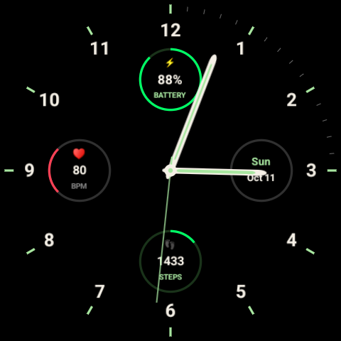

# Verl Watch Face

A custom analog watch face developed for the Google Pixel Watch 5
using Watch Face Format (WFF) v2.

## Features

- Custom analog clock with hour and minute hands
- Wear OS complications
- Custom watch face layout
- Optimized for the Pixel Watch 5

## Preview

## Requirements

- Android Studio
- Android SDK
- Wear OS device supporting WFF v2

## Development

Open the project in Android Studio and use the
Gradle build configuration to build and deploy the watch face.

Technical documentation is available in the [docs](docs/) directory.

## Project Status

**Complete**

The watch face is functional and deployed to a Pixel Watch 5.
Future improvements may be added as needed.
